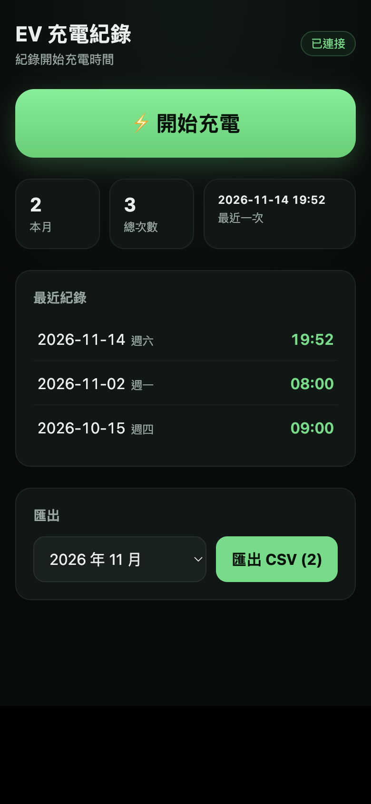

# EV Charge Log

One-tap logger for the start time of EV charging sessions. A static app on GitHub Pages; records sync through a Google Sheet using a Google Apps Script Web App. No login, no tokens.

Live app: https://happyliang12.github.io/ev-charge-log/



## Features

- One full-width button records the current time and appends it to a Google Sheet.
- Quick view: this month's count, total count, last session, and the latest five records.
- Delete any of the latest five records with a confirmation; the Sheet row is removed too.
- Loading indicators for the initial Google Sheet connection, saving a record, and deleting a record.
- CSV export for a chosen month or all months: UTF-8 BOM, CRLF, `日期,時間` columns in device-local time. Opens directly in Excel, Numbers, and Google Sheets.
- Offline-friendly: records are written to localStorage immediately and retried automatically.
- Mobile-first layout designed for a 390x844 viewport.

## One-time Google Sheet setup

1. Create a Google Sheet.
2. Open Extensions -> Apps Script and replace `Code.gs` with the contents of [`apps-script/Code.gs`](apps-script/Code.gs).
3. Set `SHEET_ID` at the top of the script to the ID from the Sheet URL (`https://docs.google.com/spreadsheets/d/<SHEET_ID>/edit`).
4. Deploy -> New deployment -> Web app. Execute as: Me. Who has access: Anyone. Authorize the requested Sheets scope. If your account or Workspace policy does not offer "Anyone" access, stop: this zero-login design requires it.
5. Copy the Web app URL. Every deployment URL is a public capability; anyone with it can read, append, or delete rows.

If you change `Code.gs` later, redeploy via Deploy -> Manage deployments -> Edit -> Version: New version. Editing the existing deployment keeps the same URL.

The first request creates the `Log` sheet and header row automatically. Columns: `id`, `startAt`, `日期`, `時間`.

## Configure

Edit `config.js`:

```js
window.APP_CONFIG = {
  API_URL: '<Apps Script Web app URL>',
  SHEET_URL: '<Google Sheet URL>',
};
```

Both values are public by design. Do not put tokens or secrets in this repository.

## Local development

```bash
python3 -m http.server 8000   # open http://127.0.0.1:8000/
npm test                      # unit tests, Node 20+
```

Mock the API in a browser without Google:

```bash
PORT=8787 node test/dev-server.mjs   # open http://127.0.0.1:8787/
```

## Deploy on GitHub Pages

```bash
gh repo create HappyLiang12/ev-charge-log --public --source=. --remote=origin --push
gh api --method POST repos/HappyLiang12/ev-charge-log/pages \
  -f "source[branch]=main" -f "source[path]=/"
```

Open https://happyliang12.github.io/ev-charge-log/.

## Security model

- No accounts and no secrets in the client. The Apps Script URL is a capability: anyone who obtains it can read, append, or delete rows.
- The API supports append and delete and has no authentication or per-user separation. Clean up or undo changes directly in the Sheet.
- The Sheet is the durable store. Clearing browser data only removes the local cache and any pending unsynced records.
- Device clock and timezone determine recorded times.
