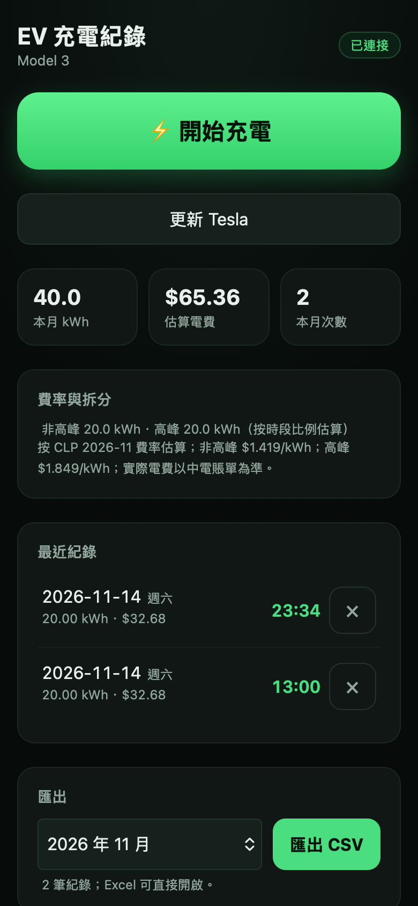

# EV Charge Log

Per-car EV charging log with on-demand Tesla Wall Connector sync and CLP peak/off-peak cost estimates. A static app on GitHub Pages; a Google Apps Script Web App owns the Sheet, Tesla OAuth, CLP rate fetch, private snapshot storage, and optional plate/VLM car suggestions.

This repository is the application code. The deployed instance is for private family use; there is no public demo deployment. Replace `<your-user>` below with your own GitHub Pages account.

Deployment target (not live until the deployment step): `https://<your-user>.github.io/ev-charge-log/`

Deployment order: cut over the Apps Script backend before publishing the static frontend. Deploy the backend first, then merge/publish the frontend.




Both screenshots are real WKWebView captures of the family and owner views at a 390x844 viewport (2x), showing the live charging card. The family start button is disabled while a manual start is pending.

## How it works

- Each car has its own family URL: `https://<your-user>.github.io/ev-charge-log/?car=<car-id>`.
- A family member taps one button when charging starts. The start time is stored in the shared Google Sheet. A pending start disables the button until it is matched or deleted.
- The owner opens the owner URL (`?owner`), presses `同步紀錄`, and the Apps Script matches Tesla Wall Connector sessions to the manual start times.
- If a driver forgot to press start, the family view lists unassigned Tesla sessions and lets that driver claim the matching one. The owner can also assign unassigned sessions. Each car gets an estimated cost from the CLP EV residential time-of-use tariff.
- A Raspberry Pi relay crops the charging slot from the Tapo CCTV stream and uploads only that crop every 5 minutes. The owner view shows the crop and a plate/vision suggestion; the family view sees only a suggestion hint, never the image.
- Capture settings live in the Sheet's `Config` tab. The Pi pulls them every cycle, so interval, crop, quality, queue cap, and cleanup cadence are tuned remotely without SSH or a restart.
- The family view never receives Tesla credentials. The owner view has no key or login; its URL is a mode flag.

## Features

- One-tap start recording with a per-car URL; no login and no car picker. While a manual start is pending, the start button is disabled and a QR auto-start does not create a second record. It re-enables after the session is matched or the pending record is deleted.
- Owner on-demand Tesla sync plus a 30-minute scheduled background sync. The family page syncs once when it loads and has no sync button; reopening the page refreshes it.
- Manual starts are matched to Tesla sessions within `MATCH_WINDOW_MINUTES` (default 30 minutes).
- Unmatched Tesla sessions appear as `unassigned` for the family or owner to assign.
- The family view shows unassigned Tesla sessions with a `認領` button, so a forgotten start can be recovered without entering a time. The latest 24 hours stay open; older sessions are grouped by month, then by day, and collapsed.
- Peak/off-peak split is estimated by session duration; Tesla does not expose a per-minute power curve.
- Recent records with start and end times, kWh, estimated cost, and real delete. Deleting a Tesla-linked record releases it back to `unassigned` for another car to claim. The end date is included when a session crosses midnight.
- kWh and estimated cost per car for a selectable period; peak/off-peak split; CLP rate month and fallback warning. The period selector includes `全部月份`, calendar months, and every saved bill period. With at least one bill, the latest bill period is selected by default so the summary lines up with the bill.
- Owner period totals, one `待配對` list that combines manual starts and unassigned charger sessions, rate cards (latest month first; older months collapsed), and copyable family links. Unassigned sessions keep the latest 24 hours open and collapse older months and days.
- UI times use 12-hour AM/PM; unassigned rows show both start and end times. CSV keeps 24-hour times.
- Month and day groups remember their open state after a claim or assign, so several sessions can be handled without reopening the groups.
- The family view shows the period summary first, published bill shares, unassigned sessions from the last 30 days, recent records, the same rate cards as the owner view, and export. Older unassigned sessions stay owner-only. Only published bills are visible; the family summary defaults to the latest published bill period.
- Owner QR code per car: scanning it opens `?car=<id>&start=1` and records the start automatically, so no start button press is needed. The owner can download the QR and stick it next to the charger or car.
- Live charging card whenever the Wall Connector reports charging, even without a manual start: state and power come from Tesla. The estimated kWh/cost counter appears only while a manual start is pending because it needs a start time; the final Tesla session replaces it. While the charger is charging without a start, the family start button is disabled (`充電樁充電中…`) because a late start cannot merge with the session, and the completed session appears after the next sync. Status responses are cached for four minutes, so several open views share one Tesla call per window.
- CSV export for family and owner, with UTF-8 BOM, CRLF, and RFC 4180 escaping.
- Owner bill reconciliation: upload a CLP PDF, extract the bill in the browser, store the numbers in the `Bills` tab, and split the bill across cars by logged kWh share. Saving a bill with peak/off-peak also learns a per-car `peakFactor` from all usable bills, so later peak/off-peak estimates track the meter's actual split.
- Bill shares are gated: a bill stays unpublished (and invisible to family links) until the owner presses `發布分攤`. Publishing is blocked while any `unassigned` session starts inside the bill period, and the server re-checks the same rule. Saving or changing a bill clears `publishedAt`, so it must be published again. If a new unassigned session later lands in a published period, family links hide that bill again until it is resolved and republished.
- Offline-friendly family queue; pending starts retry automatically.
- Private CCTV evidence: the Pi uploads only a cropped charging-slot JPEG, stored in a private Drive folder and linked from new unassigned sessions. The owner view shows the crop, engine (`車牌`/`視覺`), confidence, and adopt/manual/ignore/reassign controls; family links get a hint only.
- Owner live snapshot: the owner view loads the newest `Snapshots` row and refreshes it every 60 seconds while the tab is visible. The Pi still captures every 5 minutes, and the thumbnail loads through the owner's Google Drive session. Family payloads remain image-free.
- Plate OCR first (Cloud Vision), then an optional DeepSeek vision VLM. A unique plate match or a VLM match made against reference photos (`CarPhotos`) assigns the session automatically; a text-only VLM match stays a suggestion. An owner correction records Feedback and updates the plate map, and low-precision VLM combinations are suppressed.
- Ignoring a non-household session asks for confirmation, records `guest` feedback, and persists its Tesla key in the `Ignored` tab, so a later sync does not re-import it.
- Snapshot retention is 30 days by default. The Pi triggers a signed, hourly, batched cleanup; no ScriptApp trigger is installed.
- Mobile-first layout for a 390x844 viewport.

## CCTV evidence and remote config

The Pi relay opens a short RTSP connection each cycle and uploads one cropped JPEG. Apps Script verifies the HMAC, stores the file in a private Drive folder, appends a `Snapshots` row, and attaches the nearest snapshot to a new unassigned Tesla session. The owner view shows that crop and a suggestion; family payloads never include the evidence URL.

### Crop and fail-closed capture

- `relay.crop` is `x:y:w:h` in source pixels. The Pi applies `crop=w:h:x:y`, scales to `min(relay.imageWidth, iw)`, then encodes the JPEG at `relay.jpegQuality`.
- If `relay.crop` is empty or invalid, the relay logs `crop required` and skips capture/upload. It never falls back to a full frame. Production requires the ROI.
- `relay.crop=full` is an explicit testing-only mode for a controlled camera test; it must be removed (set back to the ROI) before production.
- Only the crop is uploaded. The full CCTV frame stays on the camera's own recording; a guest car outside the ROI is neither stored nor analysed.
- `Snapshots.crop` stores the configured `relay.crop` value at ingest (an `x:y:w:h` ROI, empty, or `full` during testing); it is kept for audit and future training data.

### Remote config keys

The `Config` tab (`key`, `value`, `updatedAt`, `notes`) is the single source of tunables. Edit it in Google Sheets; no SSH or restart is needed. `setup()` seeds missing defaults. The server clamps numeric values to the ranges below; the Pi validates and clamps again before applying. Only the `relay.*` keys are returned to the Pi by `relayConfig`; the `snapshot.*`, `vision.*`, and `policy.*` keys are read by Apps Script only.

| key | consumed by | default | range / allowed | effect |
| --- | --- | --- | --- | --- |
| `relay.enabled` | Pi | `true` | true/false | Pause capture/upload; config polling and cleanup continue |
| `relay.intervalSeconds` | Pi | `300` | 60–3600 | Capture cadence |
| `relay.imageWidth` | Pi | `1920` | 640–2560 | Output width after crop |
| `relay.jpegQuality` | Pi | `3` | 2–10 | ffmpeg `-q:v` |
| `relay.crop` | Pi | empty | `x:y:w:h` or `full` | Charging-slot ROI; empty/invalid stops capture; `full` is testing-only |
| `relay.captureTimeoutSeconds` | Pi | `30` | 10–120 | ffmpeg capture timeout |
| `relay.maxQueue` | Pi | `1000` | 100–5000 | Offline queue cap |
| `relay.cleanupIntervalSeconds` | Pi | `3600` | 600–86400 | Cleanup trigger cadence |
| `relay.cleanupBatch` | Pi | `500` | 10–1000 | Expired snapshots processed per cleanup call |
| `snapshot.retentionDays` | Apps Script | `30` | 1–365 | Drive files and `Snapshots` rows older than this are deleted |
| `snapshot.windowMinutes` | Apps Script | `10` | 1–60 | Snapshot search window around a session |
| `snapshot.candidateCount` | Apps Script | `3` | 1–5 | Max snapshots inspected per identification |
| `manual.pendingMaxAgeHours` | Apps Script | `24` | 6–72 | Pending manual starts older than this are pruned on the next start or sync |
| `vision.engine` | Apps Script | `plate` | `off`, `plate`, `plate+vlm` | Identification pipeline |
| `vision.minConfidence` | Apps Script | `0.8` | 0.5–0.99 | Minimum VLM confidence for a suggestion |
| `vision.maxPerSync` | Apps Script | `5` | 0–20 | Max sessions identified per owner sync |
| `vision.vlmModel` | Apps Script | empty | provider model id | Required for the VLM; empty fails the VLM stage |
| `policy.minSamples` | Apps Script | `5` | 1–50 | Feedback samples before a precision gate applies |
| `policy.minPrecision` | Apps Script | `0.9` | 0.5–0.99 | VLM suggestions below this precision are suppressed |

At the start of every cycle the Pi sends a signed `relayConfig` request. On success it caches the validated response at `/var/lib/ev-relay/config.json` and applies it from the next capture. On failure it uses the cache, then the `relay.env` bootstrap values; capture and cleanup keep running. `relay.enabled=false` skips capture/upload but keeps polling and cleanup. The config response contains no secrets, Sheet IDs, plates, or credentials.

### Plates, Cloud Vision, and the optional VLM

1. Fill `Plates` (`plate`, `car`, `active`, `createdAt`) with each household plate, and `Cars.description` with a short visual description used in the VLM prompt. These stay in the Sheet; never commit plates or descriptions to the repo.
2. Enable the Cloud Vision API in a Google Cloud project, create an API key, set a budget alert, and confirm the free tier (first 1,000 units/month; a billing account is required). Store the key as the `CLOUD_VISION_API_KEY` Script Property. Plate OCR uses `TEXT_DETECTION` on up to `snapshot.candidateCount` crops.
3. The optional VLM uses DeepSeek vision. Set `vision.engine=plate+vlm`, `vision.vlmModel=deepseek-flash`, and the `DEEPSEEK_API_KEY` Script Property. The DeepSeek API is user-supplied and paid; verify the model with real crops before enabling it in production. Leaving `vision.engine=plate` (the default) disables the VLM regardless of the other keys. With `plate+vlm` and no `vision.vlmModel` (or a missing `DEEPSEEK_API_KEY`), the provider is unconfigured: when plate OCR cannot decide, the session gets `suggestionStatus=error`, so the owner sees an error rather than a silent suggestion.
4. Reference photos (optional, recommended): add rows to `CarPhotos` (`carId`, `fileId`, `lighting` = `day`/`night`/`any`, `active`, `createdAt`). Each identify call sends up to three reference images (one per car, newest photo matching the session lighting, then `any`) plus the crop. A match made with references auto-assigns the car; a car without a photo falls back to its text description and stays a suggestion. Seed a row with `addCarPhotoFromSnapshot_(carId, snapshotId, lighting)` or `addCarPhotoFromFile_(carId, fileId, lighting)` in the Apps Script editor; both copy the image into the `EV Charge References` Drive folder (`REFERENCE_FOLDER_ID` Script Property overrides it), so the 30-day snapshot cleanup cannot trash it.
5. Gemini is not used. As of 2026-11-15 Hong Kong is not in the official Google AI Studio / Gemini API available-regions list, so no Gemini key or adapter is part of this deployment. Do not use a VPN to bypass the region check.
6. Evidence-backed matches assign automatically: a unique plate match, or a VLM match that used reference photos and passed `vision.minConfidence` and the per-`(engine, car, lighting)` feedback precision gate (`policy.minSamples`, `policy.minPrecision`). A text-only VLM match stays a suggestion. Automatic assignments write no Feedback row; only owner/family decisions train the gate. A provider error or rate limit is retried by sync at most once every six hours, so a recurring automation cannot turn a provider outage into an unbounded retry loop; a manual identify still retries immediately.

Secrets live only in Apps Script Script Properties; non-secret tunables live in `Config`; plates and car descriptions live in the Sheet. None of them belong in git, a report, or a chat message.

### Feedback, reassign, and ignore

- Every human decision appends a `Feedback` row: owner assign and family claim record the chosen car; owner reassign records the correction; owner ignore records `chosenCar=guest`.
- Feedback keeps the engine, suggested car, confidence, plate, snapshot id, lighting (`day` 07:00–19:00 HK, else `night`), actor, and timestamp. It is append-only and retained after snapshots expire.
- A plate correction (the suggestion had a plate and the chosen car differs) immediately upserts `Plates[plate] = chosenCar`, but only for an owner action. Plate-map tuning is owner-only: a family claim records its feedback row and never rewrites the OCR plate map. Guest/ignore choices never pollute the plate map.
- Ignore is only for unassigned sessions and asks for confirmation first, because it deletes the Log row and cannot be undone from the UI. It appends `guest` feedback, deletes the Log row from billing, and stores the Tesla session key in `Ignored` (`teslaKey`, `createdAt`, `actor`). Sync treats persisted keys as already seen, so the ignored session is not re-imported.
- Reassign is owner-only and only for assigned records. It updates the Log car, recomputes the peak/off-peak split with the new car's `peakFactor`, and records Feedback comparing the original suggestion with the chosen car. A wrong family claim is corrected the same way.

### Manual starts

- A start is accepted only when `startAt` is at most 24 hours old and no more than 5 minutes in the future; the family offline queue retries the same id, so a delayed upload still works.
- A second start for the same car within 30 minutes returns the existing pending record instead of creating a duplicate.
- Pending manual starts (`source=manual`, empty kWh, no Tesla key) expire after `manual.pendingMaxAgeHours` (default 24, range 6–72). They are pruned when that car's next start is recorded and, after the session merge phase, on every sync; a session inside the pending window still fills the row before pruning.
- The owner view has a `取消開始` button on pending rows. An unassigned leftover manual row can also be deleted or ignored; neither path writes Feedback.

### Scheduled sync

`installScheduledSync()` installs one time-driven trigger that runs `scheduledSync` every 30 minutes; `removeScheduledSync()` removes it. The handler runs the same sync and identify path as the owner's `同步紀錄` button, so a completed session imports and auto-assigns without a manual press. Each run costs one Tesla charging-history request (about 1,440/month, inside the $10 monthly discount for normal use); plate/VLM calls only happen for new sessions, and provider errors are retried at most every six hours. The manual button keeps working. Installing twice replaces the existing trigger instead of adding a second one.

### Live claim and family snapshot

When a family page opens while the charger is charging, it calls `liveClaim` once per page load. The server returns an existing claim first, dedupes per snapshot, checks that the charger is charging, and only then runs plate OCR and the reference-photo VLM against the latest crop. A match for that car writes a `source=live` row (visible as a pending record); a match for another car, an unknown verdict, low confidence, or the policy gate leaves no row. When the Tesla session completes, sync matches a claim by time containment (claim time inside the session) and fills it (`source=tesla+live`), which is the same end state as a manual start plus merge without the late-start window problem. Claims expire with `manual.pendingMaxAgeHours`.

Family links show the live crop through `?latestImage=1` (base64 JPEG served by Apps Script); the page fetches the bytes only when the snapshot id changes, so no Google Drive session is needed on family devices.

### Retention and cleanup

- `snapshot.retentionDays` defaults to 30 (range 1–365) and controls both the Drive file and its `Snapshots` row.
- Cleanup has no ScriptApp trigger: the Pi sends a signed `cleanup` request every `relay.cleanupIntervalSeconds` (default hourly) with `relay.cleanupBatch` (default 500). Apps Script trashes the oldest expired Drive files, then deletes the `Snapshots` rows whose file was trashed or is already missing; the response reports `deleted` and `failed` counts.
- A Drive trash failure keeps that `Snapshots` row so the next cleanup run retries it; failures are logged with `console.warn` in the Apps Script execution log. After every successful cleanup response the Pi logs `cleanup deleted: <n> failed: <m>`, and when `failed > 0` it also prints one warning line, so a stalled privacy retention is visible on the Pi rather than only in Apps Script. A partial failure is not a config error and does not stop later cleanup cycles. A failed cleanup request (network or rejected) is retried on the next capture cycle, because the Pi only advances `last_cleanup` on a successful response. The operation is idempotent. Log and Feedback rows are never deleted by retention. Old Log `evidenceUrl` values become stale after their snapshot is removed; this is accepted.

## Data model

The Google Sheet has up to nine tabs: `Log`, `Cars`, `Rates`, `Bills`, `Snapshots`, `Plates`, `Feedback`, `Ignored`, and `Config`. The script creates missing tabs on first use and appends missing `Log` columns to the right; existing rows are never moved or deleted.

Every script-written tab (`Snapshots`, `Feedback`, `Ignored`, `Rates`, `Bills`, `Cars`, `CarPhotos`, `Plates`) carries a `本地時間（HKT）` column with the row's primary timestamp in Hong Kong time (`YYYY-MM-DD HH:MM:SS`). The ISO columns stay UTC with a `Z` suffix. `Log` already exposes Hong Kong time through its `日期` and `時間` columns. Run `backfillLocalTimeStamps()` once after upgrading to fill existing rows; new rows are stamped on write.

### `Log`

`id`, `startAt`, `日期`, `時間`, `car`, `kWh`, `durationSec`, `teslaStartAt`, `teslaEndAt`, `peakKWh`, `offPeakKWh`, `teslaKey`, `source`, `evidenceUrl`, `suggestedCar`, `suggestionConfidence`, `suggestionPlate`, `suggestionStatus`, `identifiedAt`, `suggestionEngine`, `suggestionSnapshotId`.

- `source`: `manual`, `tesla`, `tesla+manual`, or `legacy`.
- Old rows without `car` are `legacy`; they are preserved and excluded from billing CSV.
- Tesla session keys are `<din or target_id>:<start-seconds>`.
- Date-formatted `startAt`/Tesla cells are normalized to ISO; `日期` and `時間` are derived from `startAt` in Asia/Hong_Kong.
- `evidenceUrl` is the private Drive link to the chosen crop; family payloads strip it. `suggestedCar`, `suggestionConfidence`, `suggestionPlate`, `suggestionStatus`, `identifiedAt`, `suggestionEngine`, and `suggestionSnapshotId` are written by the identifier and never change `car`. `suggestionStatus` is `matched`, `unknown`, `rate_limited`, or `error`; `suggestionEngine` is `plate`, `vlm`, or empty.

### `Cars`

`id`, `name`, `active`, `createdAt`, `peakFactor`, `description`.

- `id` matches `[a-z0-9-]{1,32}`.
- `unassigned` is reserved.
- Family URLs use this `id`.
- `peakFactor` is 0–1 and defaults to 1 (no shift). Bill calibration updates it; leave it blank or 1 for a car that charges immediately.
- `description` is a short visual description for the VLM prompt; it falls back to `name` when empty.

### `Snapshots`

`id`, `capturedAt`, `driveFileId`, `driveUrl`, `width`, `height`, `bytes`, `source`, `createdAt`, `crop`.

- One row per accepted Pi upload. The JPEG lives in the private Drive folder (`SNAPSHOT_FOLDER_ID`, or `EV Charge Snapshots` by default).
- `crop` is the configured `relay.crop` value at ingest: an `x:y:w:h` ROI, empty, or `full` during a testing capture. Remove `relay.crop=full` for production.
- Rows and Drive files are removed by retention cleanup after `snapshot.retentionDays`.

### `Plates`

`plate`, `car`, `active`, `createdAt`.

- The owner fills the household plates; plate text is never committed to the repo.
- An owner correction from Feedback upserts the mapping (plate-map tuning is owner-only); a family claim never writes it. Guest/ignore choices are not written here.

### `Rates`

`month`, `basicOffPeak`, `basicPeak`, `fuelAdjustment`, `rebate`, `peakStart`, `peakEnd`, `sourceUrl`, `fetchedAt`, `manualOverride`.

- Values are HK cents per kWh.
- `manualOverride=TRUE` rows are never overwritten by the rate refresh.
- `sourceUrl` is a comma-separated list of the CLP pages used; the owner view renders each valid URL as a separate link.
- Google Sheets may store `month` as a date cell and `peakStart`/`peakEnd` as time cells; the API normalizes the month to `YYYY-MM` and formats times in `Asia/Hong_Kong` (not with a fixed offset, because the 1899 time-cell epoch predates modern HKT).
- The read path also dedupes duplicate month rows, preferring `manualOverride` then the latest `fetchedAt`.

### `Bills`

`periodStart`, `periodEnd`, `cutoff`, `units`, `peakKWh`, `offPeakKWh`, `energyCharge`, `fuelCharge`, `others`, `total`, `fileName`, `savedAt`, `publishedAt`.

- One row per CLP bill period; saving the same `periodStart`/`periodEnd` updates the row instead of appending.
- `publishedAt` is set by `publishBill`; saving a bill clears it. Family payloads only include published bills that currently have no unassigned sessions in the period.
- `cutoff` is the instant that separates this bill from the next: sessions starting before it belong to this bill. The owner UI defaults to the end of `periodEnd`, and can infer an earlier cutoff when the bill shows a partial last month (for example 01-11 to 04-11).
- The PDF itself is never uploaded or stored; only these numbers and the file name are written.

### `Feedback`

`id`, `recordId`, `startAt`, `engine`, `suggestedCar`, `chosenCar`, `confidence`, `plate`, `snapshotId`, `lighting`, `actor`, `createdAt`.

- Append-only label set for a future offline model. `chosenCar` is an active car id or `guest` (ignored); `engine` is `plate`, `vlm`, `manual`, or empty; `actor` is `owner` or `family`.
- `lighting` is `day` (07:00–19:00 HK) or `night`, derived from the session start; it is not a camera-mode signal.
- Feedback is retained beyond snapshot retention.

### `Ignored`

`teslaKey`, `createdAt`, `actor`.

- Written when the owner ignores an unassigned session. The Log row is removed from billing and the Tesla key is retained here, so a later sync does not re-import that session.
- This tab is created on first use; it is read by sync and the ignore action.

### `Config`

`key`, `value`, `updatedAt`, `notes`.

- Non-secret tunables only. `setup()` seeds missing defaults. See the keys table above.
- Secrets (`CLOUD_VISION_API_KEY`, `DEEPSEEK_API_KEY`, `RELAY_HMAC_SECRET`) belong in Script Properties, never in this tab.

## Billing

The app uses the CLP EV residential time-of-use tariff. In 2026 the peak window is 16:00–23:00 and non-peak is 23:00–16:00.

```text
offPeakRate = basicOffPeak + fuelAdjustment - rebate
peakRate    = basicPeak    + fuelAdjustment - rebate
cost        = offPeakKWh * offPeakRate / 100 + peakKWh * peakRate / 100
```

- Rates and times are HK cents/kWh and Asia/Hong_Kong.
- The split is proportional to session duration, then shifted by the car's learned `peakFactor`; it is an estimate.
- The 8-cent/kWh 2026 special fuel rebate is not inferred. Enter an eligible rebate in the `Rates` tab and set that row's `manualOverride` to `TRUE` so `更新費率` does not overwrite it.
- The actual CLP bill remains authoritative. The owner view reconciles a bill by splitting its `total` over the logged kWh in the bill period:

```text
effective rate = bill total / logged kWh in period
car amount     = car kWh * effective rate
```

- A bill's shares become visible to family links only after the owner publishes them. Publishing is blocked while the bill period contains any `unassigned` session; assign or claim every session first. The same rule is enforced by the server and re-checked when family data is read, so a bill with new unassigned sessions disappears from family links until the period is clean and republished.

- The per-kWh split is deliberate: the bill's metered peak/off-peak registers reflect actual grid flow, while a session's recorded start can be the plug-in time rather than the start of charging. The owner view shows both the bill split and the session-based estimate, and never uses the estimate to charge a car.
- Saving a bill with peak/off-peak also calibrates a per-car `peakFactor` from all usable bills. A bill is usable when assigned car labels cover at least 90% of the period's session kWh and the sessions cover at least 80% of the bill units. The fit starts from the current factors, only applies a materially better fit, and prefers 0 or 1 but can settle on 0.25/0.5/0.75 for a mixed pattern. The new factor is applied retroactively to that car's records, and the owner toast reports every change.
- Uploading a bill extracts the period, units, total and (when present) peak/off-peak, energy, fuel and other charges. If the PDF is a scan or password-protected, the owner can enter the same fields manually.
- When the bill shows a partial last month, the cutoff is inferred by matching the last month's usage against the sessions on the final billing day; the owner can override the cutoff before saving.

## One-time setup

### 1. Google Sheet and Apps Script

1. Open the existing Google Sheet. The Sheet is currently link-shared by the owner's choice; anyone with the link can read the log and the new plates/feedback/evidence-link tabs. Set General access to Restricted if you want it private. The family view never links to it.
2. Open Extensions -> Apps Script.
3. Replace `Code.gs` and create `Logic.gs`, `SheetRepo.gs`, `Tesla.gs`, `Rates.gs`, and `Vision.gs` from [`apps-script/`](apps-script/). `Vision.gs` is new in v26 (plate OCR and the optional VLM). Other tabs (`Bills`, `Snapshots`, `Plates`, `CarPhotos`, `Feedback`, `Ignored`, `Config`) are created on first use or by `setup()`.
4. Do not edit the code. The Sheet ID is a Script Property; add `SHEET_ID` in the next section.
5. Save the project.
6. Set the Script Properties in section 2, including `SHEET_ID`.
7. In the editor, select `setup` and Run once. It creates or verifies `Log`, `Cars`, `Rates`, and `Config`, seeds the Config defaults, and checks `SHEET_ID`. Existing rows are preserved. `readLog_` alone only creates `Log`.
8. Deploy -> Manage deployments -> Edit -> Version: New version (v26 for the CCTV/evidence release). Execute as: Me. Who has access: Anyone. The existing deployment URL stays the same.

`Code.gs` is the router: `doGet` serves status, family, and owner reads and `doPost` handles the actions. Status and Tesla telemetry fetches run outside the script lock; family/owner reads and every Sheet write hold it, because reads can migrate headers and writes are read-modify-write. Sync locks only the prepare and apply phases, not the Tesla request. This replaces the legacy fixed-position `Log` API; existing rows are migrated in place and never moved or deleted.

If your account or Workspace policy does not offer "Anyone" access, stop: this zero-login design requires it.

### 2. Script Properties

In Apps Script, Project Settings -> Script Properties:

| Property | Value |
| --- | --- |
| `SHEET_ID` | ID from the Sheet URL (`https://docs.google.com/spreadsheets/d/<SHEET_ID>/edit`) |
| `TESLA_CLIENT_ID` | Tesla developer app client ID |
| `TESLA_CLIENT_SECRET` | Tesla developer app client secret |
| `TESLA_REFRESH_TOKEN` | Refresh token from the local OAuth helper |
| `TESLA_BASE_URL` | `https://fleet-api.prd.na.vn.cloud.tesla.com` (optional; this is the default) |
| `TESLA_SITE_ID` | Observed Wall Connector energy site ID; optional, discovered automatically when omitted |
| `MATCH_WINDOW_MINUTES` | `30` |
| `RELAY_HMAC_SECRET` | Shared secret for Pi snapshot/config/cleanup requests; generate with `openssl rand -hex 32` |
| `SNAPSHOT_FOLDER_ID` | Optional Drive folder ID for snapshot JPEGs; defaults to a private `EV Charge Snapshots` folder |
| `CLOUD_VISION_API_KEY` | Cloud Vision API key for plate OCR (free tier: 1,000 units/month; billing account required) |
| `DEEPSEEK_API_KEY` | DeepSeek API key for the optional vision VLM |
| `SYNC_FROM` | Leave unset; only set for an intentional backfill |
| `SYNC_CURSOR` | Internal; do not set manually |

Never put these values in `config.js`, the Sheet, git, a report, or a family link. Snapshots are stored in a private Drive folder; do not create public links.

### 3. Tesla OAuth

Tesla API access is read-only for energy data. The app uses the official Fleet API with scopes `openid offline_access energy_device_data`.

1. The Tesla developer app needs both allowed origins: `https://<your-user>.github.io` for the deployed app and `http://localhost:8788` for the local probe. Its Allowed Redirect URI must include `http://localhost:8788/callback`.
2. The app also needs its EC public key hosted at the app origin's `.well-known/appspecific/com.tesla.3p.public-key.pem` path, and partner registration completed. The probe's setup text in `tools/tesla-probe.mjs` lists the exact commands.
3. On a machine with the repository and `tools/.env.tesla.local` (mode 600) containing `TESLA_CLIENT_ID` and `TESLA_CLIENT_SECRET`, run:

```bash
npm run auth:tesla
```

3. Authorize the app in the browser. The token is saved to `tools/.tesla-refresh-token.local` with mode 600.
4. Copy the token value into the `TESLA_REFRESH_TOKEN` Script Property. Do not print it, paste it into chat, or commit it.

The owner `同步紀錄` verification happens in the owner setup step, after the frontend is deployed.

Rotate the Tesla client secret after development and deployment are complete. Update `TESLA_CLIENT_SECRET` in Script Properties, then verify one sync.

### 4. Frontend

`config.js` contains only the Apps Script URL:

```js
window.APP_CONFIG = {
  API_URL: '<Apps Script Web app URL>',
};
```

Deploy the static files to GitHub Pages. The owner view gets its Sheet link from the owner API, which derives it from the `SHEET_ID` Script Property; the Sheet URL is not committed to the repository.

### 5. Cars, rates, and the owner URL

1. Add one row per car to `Cars`: `id`, `name`, `active`, `createdAt`. Use `TRUE` for active. Leave `peakFactor` blank (defaults to 1); bill calibration fills it.
2. Open the owner URL on the deployed site: `https://<your-user>.github.io/ev-charge-log/?owner=1`.
3. Press `更新費率`; confirm the current month appears and the peak window is 16:00–23:00. If CLP changes the page format, enter or correct the row in `Rates` and set `manualOverride=TRUE`.
4. Run one owner `同步紀錄` and confirm the Wall Connector site is discovered.
5. Copy each family link from the owner view and send it to that car's driver.
6. Keep the owner URL private. The owner mode has no key or login; anyone with the URL can manage.

### 6. Deployment runbook (CCTV/evidence release, v26)

1. **Apps Script:** add `Vision.gs` as a new file and update `Code.gs`, `SheetRepo.gs`, `Logic.gs`, and `Tesla.gs` as changed. Save, then Deploy -> Manage deployments -> Edit -> Version: New version (v26). The deployment URL stays the same.
2. **Script Properties:** keep the existing values. Add `CLOUD_VISION_API_KEY` when ready; add `DEEPSEEK_API_KEY` only if the VLM is used. Enter them manually; never in chat, a report, the Sheet, or git.
3. **Config seeding:** run `setup()` once from the Apps Script editor to seed the Config defaults. Set `relay.crop` to the ROI; use `full` only for the test camera. Leave `snapshot.retentionDays=30` unless a different retention is intended.
4. **Pi:** run `sudo ev-relay-update` (or copy the new `tapo_relay.py` to `/opt/ev-relay/`), then confirm success with observable evidence rather than a log line (the relay logs config errors, capture/cleanup errors, a one-time `crop required` warning, and the cleanup `deleted`/`failed` counts; use these to diagnose, but verify the artifacts): `systemctl status ev-relay` shows the service running, `/var/lib/ev-relay/config.json` exists and its modification time advances after the first cycle (the Pi rewrites it only after a successful signed config response), and a cropped snapshot appears in the owner view (or the private Drive snapshot folder) at the next `relay.intervalSeconds`. After the first scheduled cleanup, the Pi log shows `cleanup deleted: <n> failed: <m>`; `failed` must stay 0, and a nonzero count or a `cleanup warning` line means Drive trash is failing and retention is stalling. Later tuning needs no SSH.
5. **Verify:** after plates and the Vision key are set, run one owner `同步紀錄` and confirm plate OCR on one session. Enable the VLM only after the DeepSeek provider trial. Confirm the owner UI shows the crop/suggestion, the family view shows a hint but no image, and an owner correction appends Feedback and updates `Plates` (a family claim appends Feedback only).
6. **Physical and evaluation:** install/aim the camera, capture day and night frames, set the ROI, and confirm the guest car stays outside the crop. Run at least 20 real sessions covering day/night and a guest car, review precision and unknown rates, and keep human confirmation. A 95% precision threshold is a future auto-assign gate, not enabled now.

## Local development

```bash
npm test
PORT=8787 node test/dev-server.mjs
```

Open:

- Family: `http://127.0.0.1:8787/?car=model3`
- Owner: `http://127.0.0.1:8787/?owner=1`

The mock server seeds one matched session, one unassigned session, and one pending manual session, and reports a live 7.2 kW charging status.

Node 20+ is required for the built-in test runner (verified on v20.20.2). There are no runtime dependencies and no build step; `jsdom` is a test-only devDependency installed by `npm ci`.

## API

`GET`:

- `?car=<id>` returns `{ ok, car, records, unassigned, rates, bills, serverTime }` for that car. `unassigned` is the list of unclaimed Tesla sessions. `bills` contains published bill shares only: `{ periodStart, periodEnd, cutoff, units, peakKWh, offPeakKWh, total, loggedKWh, myKWh, myShare, myAmount, publishedAt }`. Evidence URLs are stripped from every family record.
- `?owner` returns `{ ok, cars, records, rates, bills, sheetUrl, serverTime }` for the owner; each car includes `peakFactor` and `description`, and records include the suggestion fields and private `evidenceUrl`.
- `?status=1` returns `{ ok, charging, powerW, energyWh, state, available, sampledAt }` from the Wall Connector live status. `energyWh` may be null.

`POST` with a `text/plain` JSON body:

- `{ action: 'append', id, car, startAt, date, time }`
- `{ action: 'delete', id, car }`
- `{ action: 'sync' }` (all cars) or `{ action: 'sync', car }`
- `{ action: 'assign', id, car }`
- `{ action: 'claim', car, id }` (family-scoped unassigned claim)
- `{ action: 'identify', id, force? }` (owner; runs plate/VLM identification without assigning)
- `{ action: 'ignore', id }` (owner; only unassigned; records `guest` feedback and the Ignored Tesla key)
- `{ action: 'reassign', id, car }` (owner; only assigned; recomputes the peak split)
- `{ action: 'refreshRates' }`
- `{ action: 'bill', bill: { periodStart, periodEnd, cutoff, units, peakKWh, offPeakKWh, energyCharge, fuelCharge, others, total, fileName } }` returns `{ ok, bill, calibration }`; saving a bill with peak/off-peak refits per-car factors and reports `{ applied, billsUsed, updatedCars, recomputed, periods }`. Saving clears `publishedAt`.
- `{ action: 'publishBill', periodStart, periodEnd }` returns `{ ok, bill, allocation }` and sets `publishedAt`. It is rejected if the period still contains any `unassigned` session or has no assigned kWh.
- `{ action: 'snapshot', id, capturedAt, width, height, image, signature }` and `{ action: 'relayConfig', at, signature }` and `{ action: 'cleanup', at, limit, signature }` are Pi-only, HMAC-signed with `RELAY_HMAC_SECRET`, and reject a timestamp outside ±10 minutes. `snapshot` accepts a JPEG body up to the image limit and is idempotent by id; `relayConfig` returns only the parsed `relay.*` values and `updatedAt`; `cleanup` trashes expired Drive files and deletes the `Snapshots` rows whose file was trashed or already missing, returning `{ deleted, failed }` counts (a failed trash keeps the row for the next cleanup).

The response envelope is `{ ok: true, ... }` or `{ ok: false, error }`. Apps Script returns HTTP 200 for API errors; the client checks `ok`.

## Security

- No accounts and no secrets in the frontend. The Apps Script URL and each family `?car=` URL are capabilities.
- Each family `?car=` URL is a capability: anyone who has it can append and delete that car's records and claim unassigned Tesla sessions to that car. Share it only with that car's driver.
- A car QR encodes the same family URL plus `start=1`; anyone who scans it can start a charge for that car. Treat the QR like the family link.
- The owner view is selected by `?owner` and has no key or login. Anyone who has the app URL and adds `?owner` can sync Tesla, refresh rates, assign sessions, and export. Keep the owner URL private; this is an accepted trade-off for a family-only app.
- Tesla credentials live only in Script Properties.
- Snapshot JPEGs are stored in a private Drive folder; nothing is published. Family payloads omit `evidenceUrl`, so a family link never receives the image or its Drive link.
- Only the cropped charging-slot image is uploaded. The full CCTV frame stays on the camera's own recording; `relay.crop=full` is a controlled-test exception.
- Cloud Vision and DeepSeek credentials live only in Script Properties. The `Config` tab holds non-secret tunables; plates and car descriptions stay in the Sheet. Never commit or paste any of them.
- Snapshot, config, and cleanup requests use HMAC-SHA256 with a ±10-minute timestamp window; snapshot ingest also enforces body/image limits, JPEG magic, and idempotency.
- Bill PDFs are parsed in the browser and never uploaded; only the extracted bill numbers and the file name are stored in the Sheet.
- The Sheet is link-shared as of the current owner choice; anyone with the link can read the log. It now also holds plates, car descriptions, feedback, and private evidence links, so set General access to Restricted if you want it private. The link is not in this repository: `SHEET_ID` is a Script Property and the owner API derives the link.
- Family actions require a valid car ID; owner actions require only the Apps Script Web App URL.
- `index.html` uses `<meta name="referrer" content="no-referrer">`; owner external links use `rel="noreferrer"`.
- A leaked family URL allows that car's append/delete and claims. Remove the car from the `Cars` tab to stop the old link; existing records stay in the `Log`.
- A leaked Tesla secret or refresh token must be rotated. Rotate the client secret in the Tesla developer portal and replace `TESLA_CLIENT_SECRET`; revoke the app grant if a refresh token leaked.
- If the owner URL is exposed, create a new Apps Script deployment URL and update `config.js`; every family link keeps working after the frontend redeploy.

## Known limits

- Tesla cannot identify which car used the Wall Connector. Attribution is the per-car URL plus manual start.
- If a driver forgets to press start, the session becomes `unassigned`; the family can claim it or the owner can assign it.
- Peak/off-peak is estimated from session start and duration, then shifted by the car's learned `peakFactor`. It is still not measured per minute, so an irregular schedule can differ from the bill; charge cars from the bill total split by kWh share, not from the peak/off estimate.
- The vehicle may report DC-side energy; the AC meter can differ.
- CLP page scraping and PDF extraction are fragile. If the PDF text cannot be parsed (for example a scan or password-protected file), enter the bill fields manually; nothing is uploaded.
- The live charging kWh/cost is an estimate from the last Wall Connector power sample; the completed Tesla session is authoritative. The card polls every 5 minutes while the page is visible (one Tesla call per poll) and interpolates every second.
- There is no cron for Tesla sync and no ScriptApp cleanup trigger. Snapshot cleanup is triggered by the Pi every hour by default; if the Pi is offline, expired snapshots remain until it returns. There is no outside-charger support.
- The plate may be outside the crop (for example a side-on car), and night/IR frames may be unreadable. The VLM and manual selection are required fallbacks, not optional.
- Cloud Vision's free tier and the paid DeepSeek API can be rate-limited or unavailable in Hong Kong; plate OCR and manual selection keep working without the VLM. No automatic assignment is enabled.
- Old `evidenceUrl` links become stale after snapshot retention; the Log row and Feedback remain.
- If trashing a Drive file fails transiently (rate limit or service error), its `Snapshots` row is kept and retried at the next cleanup run; a file is only orphaned if it is missing permissions or the row is removed by hand. A partial failure appears in the Apps Script execution log and in the Pi log as `cleanup deleted: N failed: M` plus one `cleanup warning` line.
- `同步紀錄` on the owner view initializes the last 30 days as unassigned sessions when there is no cursor, `SYNC_FROM`, or manual start. Family page loads do not initialize that window. Each sync is one Tesla telemetry request, not one request per session.
- CSV is a snapshot; refresh it after new records.
- CSV content is unit-tested; the owner export button and toast were smoke-tested in WKWebView. File delivery in a normal browser is unverified until a live end-to-end run.

## Tests

```bash
npm test
```

The suite currently has 215 tests and covers frontend logic, API payloads, Apps Script logic, Sheet migration, Sheet date-cell coercion, Tesla token/session mapping, CLP parsers, rate validation, duplicate-rate handling, bill PDF parsing (including the inferred cutoff), bill storage/allocation, bill-period filtering, publish gating, per-car peak-factor calibration, owner actions, family claims, QR auto-start URLs, duplicate-start refusal, delete-release behavior, lock scope, live charging estimates, 12-hour Hong Kong time, remote config parsing/clamping and signatures, crop command construction and fail-closed capture, snapshot ingest and retention cleanup (including Drive trash success, failure, and missing-file paths), plate/VLM identification and policy suppression, feedback/reassign/ignore (including the Ignored sync skip), and the API envelope. Twenty-one jsdom integration tests drive the real UI modules against the Apps Script VM with mocked Tesla, CLP, and Sheet data. The bill upload path was verified in a real browser against a real CLP bill export, including its split-cell sub-period rows; the parser also normalizes NFKC compatibility CJK forms. Browser smoke tests are documented in the implementation plan.

CI: [`.github/workflows/test.yml`](.github/workflows/test.yml) runs `npm ci && npm test` on Node 20 for every push and pull request.

## License

Personal project; no license file.
