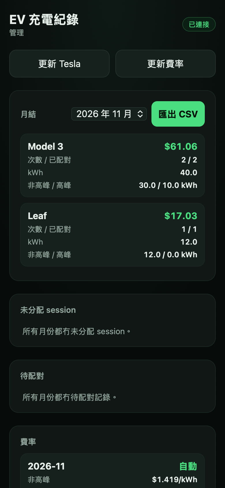

# EV Charge Log

Per-car EV charging log with on-demand Tesla Wall Connector sync and CLP peak/off-peak cost estimates. A static app on GitHub Pages; a Google Apps Script Web App owns the Sheet, Tesla OAuth, and CLP rate fetch.

Deployment target (the new UI is not live until the deployment step): https://happyliang12.github.io/ev-charge-log/

Deployment order: do not merge or publish the static frontend before the Apps Script backend is cut over. The live frontend currently points at the legacy deployment; deploy the backend first, then merge/publish the frontend.




Both screenshots are real WKWebView captures of the family and owner views at a 390x844 viewport (2x).

## How it works

- Each car has its own family URL: `https://happyliang12.github.io/ev-charge-log/?car=<car-id>`.
- A family member taps one button when charging starts. The start time is stored in the shared Google Sheet.
- The owner opens the owner URL (`?owner=<owner-key>`), presses `更新 Tesla`, and the Apps Script matches Tesla Wall Connector sessions to the manual start times.
- If a driver forgot to press start, the family view lists unassigned Tesla sessions and lets that driver claim the matching one. The owner can also assign or ignore unassigned sessions. Each car gets an estimated cost from the CLP EV residential time-of-use tariff.
- The family view never receives Tesla credentials or the owner key. The owner view receives the owner key from its URL and keeps it in memory.

## Features

- One-tap start recording with a per-car URL; no login and no car picker.
- On-demand Tesla sync; no scheduled background sync. The family page syncs once when it loads.
- Manual starts are matched to Tesla sessions within `MATCH_WINDOW_MINUTES` (default 30 minutes).
- Unmatched Tesla sessions appear as `unassigned` for the family to claim or the owner to assign/ignore.
- The family view shows unassigned Tesla sessions with a `認領` button, so a forgotten start can be recovered without entering a time.
- Peak/off-peak split is estimated by session duration; Tesla does not expose a per-minute power curve.
- Monthly kWh and estimated cost per car; peak/off-peak split; CLP rate month and fallback warning.
- Recent records with kWh, estimated cost, and real delete.
- Owner month totals, unassigned and pending lists, rate cards, and copyable family links.
- CSV export for family and owner, with UTF-8 BOM, CRLF, and RFC 4180 escaping.
- Offline-friendly family queue; pending starts retry automatically.
- Mobile-first layout for a 390x844 viewport.

## Data model

The Google Sheet has four tabs. The script creates missing tabs and appends missing `Log` columns to the right; existing rows are never moved or deleted.

### `Log`

`id`, `startAt`, `日期`, `時間`, `car`, `kWh`, `durationSec`, `teslaStartAt`, `teslaEndAt`, `peakKWh`, `offPeakKWh`, `teslaKey`, `source`.

- `source`: `manual`, `tesla`, `tesla+manual`, or `legacy`.
- Old rows without `car` are `legacy`; they are preserved and excluded from billing CSV.
- Tesla session keys are `<din or target_id>:<start-seconds>`.

### `Cars`

`id`, `name`, `active`, `createdAt`.

- `id` matches `[a-z0-9-]{1,32}`.
- `unassigned` is reserved.
- Family URLs use this `id`.

### `Rates`

`month`, `basicOffPeak`, `basicPeak`, `fuelAdjustment`, `rebate`, `peakStart`, `peakEnd`, `sourceUrl`, `fetchedAt`, `manualOverride`.

- Values are HK cents per kWh.
- `manualOverride=TRUE` rows are never overwritten by the rate refresh.
- `sourceUrl` is a comma-separated list of the CLP pages used.

### `Ignored`

`teslaKey`, `ignoredAt`, `reason`.

- Deleting or ignoring a Tesla-linked record adds its key here so it is not imported again.

## Billing

The app uses the CLP EV residential time-of-use tariff. In 2026 the peak window is 16:00–23:00 and non-peak is 23:00–16:00.

```text
offPeakRate = basicOffPeak + fuelAdjustment - rebate
peakRate    = basicPeak    + fuelAdjustment - rebate
cost        = offPeakKWh * offPeakRate / 100 + peakKWh * peakRate / 100
```

- Rates and times are HK cents/kWh and Asia/Hong_Kong.
- The split is proportional to session duration; it is an estimate.
- The 8-cent/kWh 2026 special fuel rebate is not inferred. Enter an eligible rebate in the `Rates` tab and set that row's `manualOverride` to `TRUE` so `更新費率` does not overwrite it.
- The actual CLP bill remains authoritative. Per-bill reconciliation is a future enhancement.

## One-time setup

### 1. Google Sheet and Apps Script

1. Open the existing Google Sheet. The Sheet is currently link-shared by the owner's choice; anyone with the link can read the log. Set General access to Restricted if you want it private. The family view never links to it.
2. Open Extensions -> Apps Script.
3. Replace `Code.gs` and create `Logic.gs`, `SheetRepo.gs`, `Tesla.gs`, and `Rates.gs` from [`apps-script/`](apps-script/).
4. Set `SHEET_ID` at the top of `Code.gs` to the ID from the Sheet URL (`https://docs.google.com/spreadsheets/d/<SHEET_ID>/edit`).
5. Save the project.
6. Deploy -> Manage deployments -> Edit -> Version: New version. Execute as: Me. Who has access: Anyone. The existing deployment URL stays the same.

`Code.gs` is the router: `doGet` serves family and owner reads and `doPost` handles the actions. Both paths hold the Apps Script script lock because reads can migrate headers. This replaces the legacy fixed-position `Log` API; existing rows are migrated in place and never moved or deleted.

If your account or Workspace policy does not offer "Anyone" access, stop: this zero-login design requires it.

### 2. Script Properties

In Apps Script, Project Settings -> Script Properties:

| Property | Value |
| --- | --- |
| `TESLA_CLIENT_ID` | Tesla developer app client ID |
| `TESLA_CLIENT_SECRET` | Tesla developer app client secret |
| `TESLA_REFRESH_TOKEN` | Refresh token from the local OAuth helper |
| `TESLA_BASE_URL` | `https://fleet-api.prd.na.vn.cloud.tesla.com` (optional; this is the default) |
| `TESLA_SITE_ID` | Observed Wall Connector energy site ID; optional, discovered automatically when omitted |
| `OWNER_KEY` | 48 lowercase hex characters; generate with `openssl rand -hex 24` |
| `MATCH_WINDOW_MINUTES` | `30` |
| `SYNC_FROM` | Leave unset; only set for an intentional backfill |
| `SYNC_CURSOR` | Internal; do not set manually |

Never put these values in `config.js`, the Sheet, git, or a family link.

### 3. Tesla OAuth

Tesla API access is read-only for energy data. The app uses the official Fleet API with scopes `openid offline_access energy_device_data`.

1. The Tesla developer app needs both allowed origins: `https://happyliang12.github.io` for the deployed app and `http://localhost:8788` for the local probe. Its Allowed Redirect URI must include `http://localhost:8788/callback`.
2. The app also needs its EC public key hosted at the app origin's `.well-known/appspecific/com.tesla.3p.public-key.pem` path, and partner registration completed. The probe's setup text in `tools/tesla-probe.mjs` lists the exact commands.
3. On a machine with the repository and `tools/.env.tesla.local` (mode 600) containing `TESLA_CLIENT_ID` and `TESLA_CLIENT_SECRET`, run:

```bash
npm run auth:tesla
```

3. Authorize the app in the browser. The token is saved to `tools/.tesla-refresh-token.local` with mode 600.
4. Copy the token value into the `TESLA_REFRESH_TOKEN` Script Property. Do not print it, paste it into chat, or commit it.

The owner `更新 Tesla` verification happens in the owner setup step, after the frontend is deployed.

Rotate the Tesla client secret after development and deployment are complete. Update `TESLA_CLIENT_SECRET` in Script Properties, then verify one sync.

### 4. Frontend

`config.js` contains only public values:

```js
window.APP_CONFIG = {
  API_URL: '<Apps Script Web app URL>',
  SHEET_URL: '<Google Sheet URL>',
};
```

Deploy the static files to GitHub Pages. The owner key is never in `config.js`.

### 5. Cars, rates, and the owner URL

1. Add one row per car to `Cars`: `id`, `name`, `active`, `createdAt`. Use `TRUE` for active.
2. Open the owner URL on the deployed site: `https://happyliang12.github.io/ev-charge-log/?owner=<OWNER_KEY>`.
3. Press `更新費率`; confirm the current month appears and the peak window is 16:00–23:00. If CLP changes the page format, enter or correct the row in `Rates` and set `manualOverride=TRUE`.
4. Run one owner `更新 Tesla` and confirm the Wall Connector site is discovered.
5. Copy each family link from the owner view and send it to that car's driver.
6. Keep the owner URL private. It is a capability, not a login.

## Local development

```bash
npm test
PORT=8787 node test/dev-server.mjs
```

Open:

- Family: `http://127.0.0.1:8787/?car=model3`
- Owner: `http://127.0.0.1:8787/?owner=aaaaaaaaaaaaaaaaaaaaaaaaaaaaaaaaaaaaaaaaaaaaaaaa`

The mock server seeds one matched session, one unassigned session, and one pending manual session.

Node 20+ is required for the built-in test runner (verified on v20.20.2). There are no npm dependencies and no build step.

## API

`GET`:

- `?car=<id>` returns `{ ok, car, records, unassigned, rates, serverTime }` for that car. `unassigned` is the list of unclaimed Tesla sessions.
- `?owner=<key>` returns `{ ok, cars, records, rates, serverTime }` for the owner.

`POST` with a `text/plain` JSON body:

- `{ action: 'append', id, car, startAt, date, time }`
- `{ action: 'delete', id, car }` or `{ action: 'delete', id, ownerKey }`
- `{ action: 'sync', car }` or `{ action: 'sync', ownerKey }`
- `{ action: 'assign', ownerKey, id, car }`
- `{ action: 'claim', car, id }` (family-scoped unassigned claim)
- `{ action: 'ignore', ownerKey, id }`
- `{ action: 'refreshRates', ownerKey }`

The response envelope is `{ ok: true, ... }` or `{ ok: false, error }`. Apps Script returns HTTP 200 for API errors; the client checks `ok`.

## Security

- No accounts and no secrets in the frontend. The Apps Script URL and owner key are capability URLs.
- Each family `?car=` URL is a capability: anyone who has it can append and delete that car's records and claim unassigned Tesla sessions to that car. Share it only with that car's driver.
- Tesla credentials live only in Script Properties.
- The Sheet is link-shared as of the current owner choice; anyone with the link can read the log. The family view does not link to it. Set General access to Restricted if you want it private.
- Owner actions require `OWNER_KEY`; family actions require a valid car ID.
- The owner key is kept in memory from the URL; it is not written to localStorage, logs, CSV, or family links.
- `index.html` uses `<meta name="referrer" content="no-referrer">`; owner external links use `rel="noreferrer"`.
- A leaked owner key allows owner actions. Rotate `OWNER_KEY` and resend the new owner URL; family URLs keep working.
- A leaked Tesla secret or refresh token must be rotated. Rotate the client secret in the Tesla developer portal and replace `TESLA_CLIENT_SECRET`; revoke the app grant if a refresh token leaked.

## Known limits

- Tesla cannot identify which car used the Wall Connector. Attribution is the per-car URL plus manual start.
- If a driver forgets to press start, the session becomes `unassigned`; the family can claim it or the owner can assign it.
- Peak/off-peak is duration-proportional, not measured per minute.
- The vehicle may report DC-side energy; the AC meter can differ.
- CLP page scraping is fragile. Manual `Rates` rows are the fallback.
- There is no cron, scheduled background sync, outside-charger support, CCTV integration, or bill reconciliation yet.
- CSV is a snapshot; refresh it after new records.
- CSV content is unit-tested; the owner export button and toast were smoke-tested in WKWebView. File delivery in a normal browser is unverified until a live end-to-end run.

## Tests

```bash
npm test
```

The suite currently has 85 tests and covers frontend logic, API payloads, Apps Script logic, Sheet migration, Tesla token/session mapping, CLP parsers, owner actions, family claims, and the API envelope. Browser smoke tests are documented in the implementation plan.

CI: [`.github/workflows/test.yml`](.github/workflows/test.yml) runs `npm test` on Node 20 for every push and pull request.

## License

Personal project; no license file.
